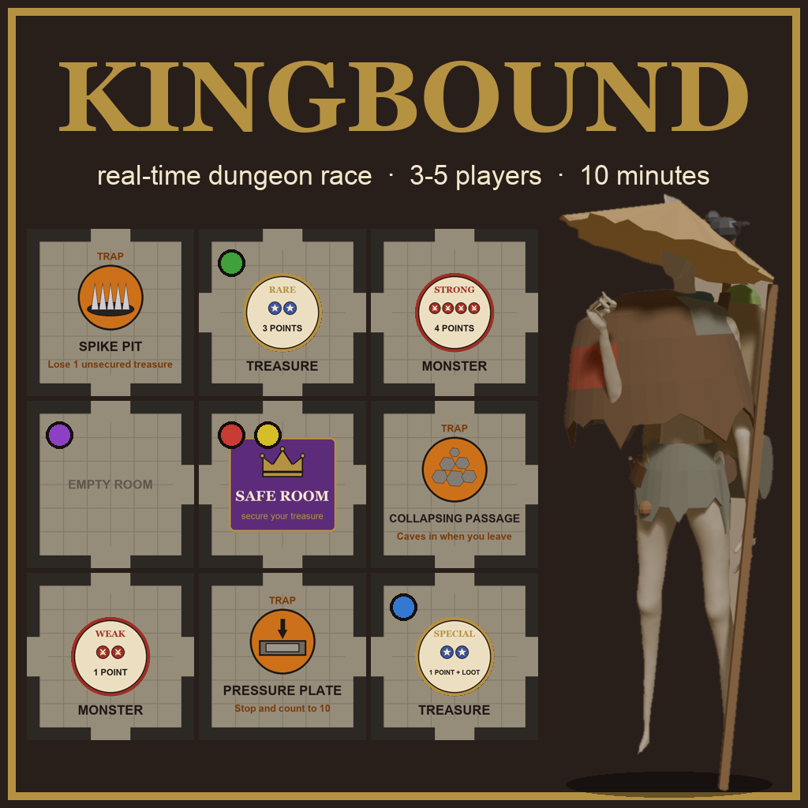

# Kingbound

Kingbound is a real-time dungeon race for 3 to 5 players, played in Tabletop Simulator. There are no turns. For 10 minutes everyone rolls their dice at the same time, opens new rooms, fights monsters and grabs treasure. Treasure only counts once you have carried it back to the Safe Room. When the timer runs out, the player with the most points wins.

## Getting the game

Subscribe to [Kingbound on the Steam Workshop](https://steamcommunity.com/sharedfiles/filedetails/?id=3827233466). In Tabletop Simulator it is then under Games → Workshop.

You can also download `KINGBOUND-realtime.json` from the [latest release](https://github.com/All1os/kingbound/releases/latest) and put it in your Tabletop Simulator Saves folder (`Documents/My Games/Tabletop Simulator/Saves` on Windows, `~/Library/Tabletop Simulator/Saves` on a Mac). It shows up under Games → Save & Load.

## Starting a game

Sit at Red, Yellow, Green, Blue or Purple and press START GAME at the top left of the screen. It shuffles the decks, gives everyone 4 dice, puts all the characters in the Safe Room and starts the 10-minute timer. RESET TABLE puts everything back where it was.

## How to play

Each die shows Movement (green), Attack (red) or Magic (blue). Roll whenever you want, keep the dice you need and reroll the rest as often as you like. When you have the symbols for an action, do it.

| Action | Dice |
|---|---|
| Move to a connected room | 2 Movement |
| Open a new room | 2 Movement |
| Beat a weak monster | 2 Attack |
| Beat a medium monster | 3 Attack |
| Beat a strong monster | 4 Attack |
| Take a treasure | 2 Magic |
| Secure your treasure, standing in the Safe Room | none |

To open a room, take the top card of the room deck, flip it and lay it next to the room you are in so that the passages connect. If it is a monster room or a treasure room, put the top card of that token deck face up on it. You fight a monster or take a treasure in its own room.

A beaten monster goes straight to the POINTS box on your mat. A treasure goes to the CARRIED box first. It counts only after you bring it back to the Safe Room and move it to POINTS.

Six of the rooms are traps, and a trap goes off every time someone walks in.

- Spike Pit: lose one treasure you are carrying.
- Pressure Plate: put your dice down and count to 10 out loud.
- Collapsing Passage: when you walk out, the room caves in. Put a rubble token on it. Nobody can go in again.

A special treasure also gives you a Loot card. Weapons and equipment count as one extra symbol of their kind. One-use items are discarded after you use them. Prank cards are played against another player: steal a treasure they carry, push them into the next room, pull the nearest monster to them, or set off a trap where they stand. Nobody can prank a player who is in the Safe Room.

When the timer reaches 0:00, everyone stops and counts their POINTS box. If two players have the same score, the one who beat more monsters wins.

## Versions

See the [changelog](CHANGELOG.md). Version 0.1 was an earlier, turn-based design of Kingbound. It is in the [turn-based](turn-based) folder, and its rules are in [Kingbound-GDD.pdf](turn-based/Kingbound-GDD.pdf).
