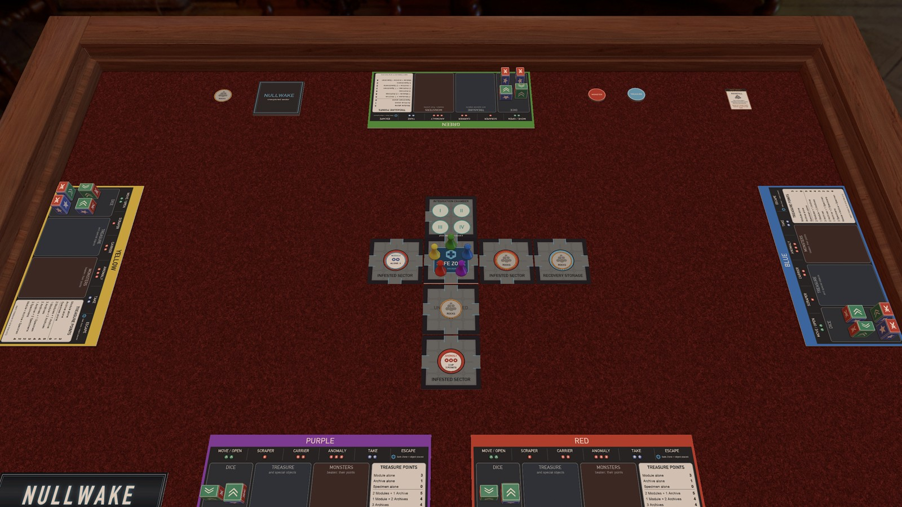

# NULLWAKE

NULLWAKE (until v2.0 called Kingbound) is a real-time race for 3 to 5 players, played in Tabletop Simulator. An expedition explores ORPHEON, an abandoned research station: unknown creatures live in its rooms, and valuable discoveries are left behind. There are no turns. For 10 minutes everyone rolls their dice at the same time, opens new sectors, fights creatures and collects treasure. In round 1 you collect points; in round 2 the station starts to collapse and you have to escape. Only the players who escape keep their points.

## Getting the game

Subscribe to [the game on the Steam Workshop](https://steamcommunity.com/sharedfiles/filedetails/?id=3827233466). In Tabletop Simulator it is then under Games → Workshop.

You can also download `NULLWAKE.json` from the [latest release](https://github.com/All1os/kingbound/releases/latest) and put it in your Tabletop Simulator Saves folder (`Documents/My Games/Tabletop Simulator/Saves` on Windows, `~/Library/Tabletop Simulator/Saves` on a Mac). It shows up under Games → Save & Load.

## Starting a game

Sit at Red, Yellow, Green, Blue or Purple: pick the colour when you join, or later by clicking your name at the top right and choosing Change Color. Each player's mat lies on their own side of the table: Red in the south, Yellow in the west, Green in the north, Blue in the east, and Purple next to Red for a fifth player. The top of the mat shows what each action needs, and the right side lists the treasure points. Press START GAME at the top left of the screen. It shuffles the decks, gives everyone 4 dice, puts all the characters in the Safe Zone and starts the 10-minute timer with round 1. RESET TABLE puts everything back where it was.

## How to play

Everyone plays in cycles, at the same time:

1. Everyone rolls their 4 dice (ROLL DICE at the top left).
2. Each player keeps the dice they want and rerolls the others once (point at a die and press R).
3. Everyone uses their results. Each die is used once.
4. When everyone is done, the next cycle starts.

Each die shows Movement (green), Attack (red) or Magic (blue).

| Action | Dice |
|---|---|
| Move to a connected room | 2 Movement |
| Open a new room (round 1 only) | 2 Movement |
| Damage a monster in your room | 1 Attack for each damage |
| Take a treasure or a special object in your room | 2 Magic |

To open a room, take the top card of the room deck, flip it and lay it next to the room you are in so that the passages connect. If it is an Infested Sector or a Recovery Storage, put the top card of that token deck face up on it.

### Monsters

| Monster | HP | Points |
|---|---|---|
| Scraper | 1 | 1 |
| Carrier | 2 | 2 |
| Anomaly | 3 | 3 |

Each Attack deals 1 damage, and the damage stays from one cycle to the next. Right-click a monster and choose Hit for each damage: its name shows the HP left. At 0 HP it goes to the MONSTERS box on your mat. You don't have to fight: you can look for another route.

### Treasure

There are three types: Modules, Archives and Specimens. Put the ones you take in the TREASURE box. At the end you group them: each treasure counts in one line of the table only, and you choose the lines.

| Treasure | Points |
|---|---|
| A Module alone | 3 |
| An Archive alone | 1 |
| A Specimen alone | 0 |
| 2 Modules + 1 Archive | 5 |
| 1 Module + 2 Archives | 4 |
| 3 Archives | 4 |
| 2 Archives + 1 Specimen | 3 |
| 1 Archive + 2 Specimens | 2 |
| 3 Specimens | 2 |
| Module + Archive + Specimen | 4 |

### Special objects

Four special objects lie in their own deck, apart from the treasure tokens. Taking one needs 2 Magic. The Integration Chamber is a room with four slots. In round 2, drop your object on it: that completes your special task.

### Round 2: escape

At 5:00 round 2 starts and no new rooms can be opened. Turn up one event card from the deck of eight and set it up by hand: the rock, gas, black hole, alien and Safe Zone tokens and the second Integration Chamber lie beside the table.

| Card | What happens |
| --- | --- |
| Rockfall | Rocks fill every Unregistered Sector (the empty rooms) with nobody in it. Nobody can go through them. |
| Lost Path | The Safe Zone moves to a room 5 rooms away (or the farthest one), marked with a Safe Zone token. Escape there instead. |
| Time Freeze | Nobody can move for 15 seconds. Fighting and taking treasure go on. |
| Extra Risk | Draw one or two more event cards. Every card drawn happens. |
| Extra Special Tile | A second Integration Chamber joins the station. An object placed on either chamber completes your special task. |
| Poison Gas | Gas fills an empty room and the rooms beside it. Each time you enter a room with gas, you lose 1 point. |
| Aliens | Every monster in a room becomes an alien: 1 HP more, same points. You can't go through its room without beating it. |
| Black Holes | A black hole opens in every room with treasure. Each time you go through one, you lose 1 point. |

The table counts the points lost to gas and black holes (a character dropped in a room with one of those tokens) and shows them at 0:00. If a Safe Zone token lies on the table, that room is where you escape to.

When the timer reaches 0:00, everyone stops. A player who is in the Safe Zone and has completed the special task keeps their points: beaten monsters plus treasure, minus what gas and black holes cost. Everyone else loses all their points. The most points wins; a tie is a draw.

## Versions

See the [changelog](CHANGELOG.md). Version 0.1 was an earlier, turn-based design of Kingbound. It is in the [turn-based](turn-based) folder, and its rules are in [Kingbound-GDD.pdf](turn-based/Kingbound-GDD.pdf).
